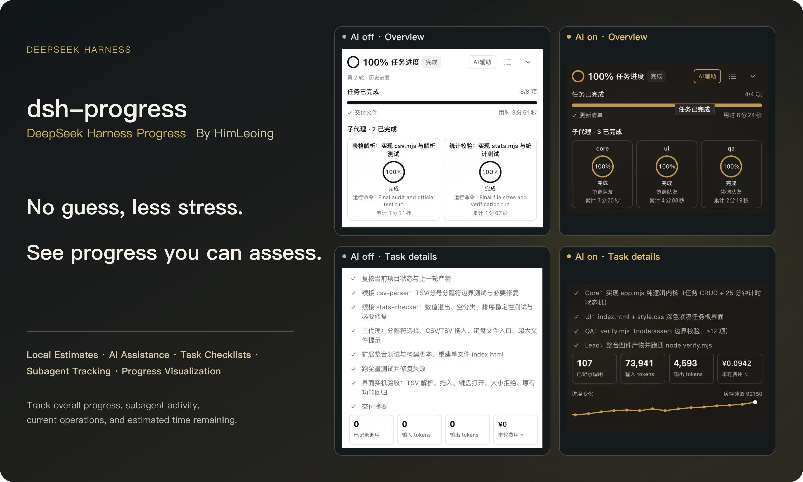
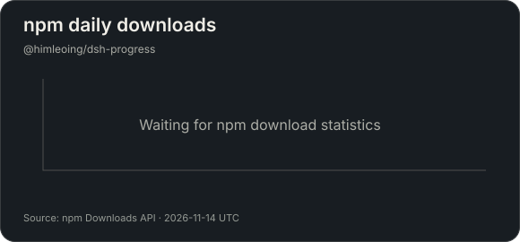
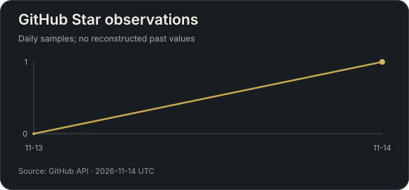

<p align="center"></p>

<p align="center"><a href="#install">Install</a> · <a href="#two-assessment-modes">Assessment modes</a> · <a href="#panel-layout">Panel layout</a> · <a href="README.zh-CN.md">中文</a> · <a href="https://github.com/HimLeoing/dsh-progress/releases">Releases</a></p>

**dsh-progress** adds task progress to [DeepSeek Harness](https://github.com/deepseek-ai/deepseek-harness) Web. See overall progress, current work, estimated remaining time, and each teammate's progress. Choose local estimation or AI assistance, and open details when needed.

## Two assessment modes

<table>
<tr><th width="50%">Local estimation</th><th width="50%">AI assistance</th></tr>
<tr><td align="center"></td><td align="center"><br><sub>Assessment usage and trend after completion</sub><br></td></tr>
<tr><td>Estimates informed by execution evidence, task stages, and checklist weights. Works without prior history.</td><td>Model assessments at execution boundaries, informed by checklist weights and teammate progress.</td></tr>
<tr><td>No additional model requests. Approximate percentages and remaining time shown in minutes.</td><td>Approximate percentages, remaining time counting in seconds, and combined lead/teammate probe cost estimates.</td></tr>
</table>

Both modes support checklists, independent teammate progress, and switching during a run. AI assistance is off by default and can incur provider charges when enabled. Percentages and remaining time are estimates; rework can reduce progress. All product images below come from real task execution.

## Panel layout

<p align="center"></p>

## Task details and developer mode

<table>
<tr><th width="50%">Task details</th><th width="50%">Developer mode</th></tr>
<tr><td align="center" valign="top"><a href="docs/assets/task-details.png"></a></td><td align="center" valign="top"><a href="docs/assets/developer-mode.png"></a></td></tr>
<tr><td>Open the checklist, progress trend, and probe usage together. Cost estimates are built in.</td><td>Record call times and full inputs and outputs while enabled. Logs stay on your machine and can be viewed or downloaded.</td></tr>
</table>

Both screenshots come from one real verification run: three checklist items, 97 passing tests, and five assessments. Click an image for its original size. Developer mode is off by default.

## From start to finish

<table><tr><th>Start</th><th>In progress</th><th>Complete</th></tr><tr><td></td><td></td><td></td></tr></table>

<details><summary>Dark and light appearances</summary>

<table><tr><th>Dark</th><th>Light</th></tr><tr><td></td><td></td></tr></table>

</details>

## How it works

<p align="center"></p>

## Install

Requires **DeepSeek Harness >=0.2.2-rc.1** (Web and Desktop) and **Node.js >=24.9.0**. Tested on Harness 0.2.2-rc.3.

Install from npm:

```sh
dsh plugin --profile web add "@himleoing/dsh-progress@0.1.1-rc3"
```

Or install the same version from GitHub:

```sh
dsh plugin --profile web add "github:HimLeoing/dsh-progress#v0.1.1-rc3"
```

Or download the .tgz archive from the [release](https://github.com/HimLeoing/dsh-progress/releases/tag/v0.1.1-rc3). Enable the bundle, restart Harness, and reload the Web UI. Eligible legacy data is copied when destination files are absent; originals remain intact.

Normal mode checks newer RC releases. Developer mode also checks newer Alpha releases. A circular update button appears beside the version in task details when an eligible release is available.

## Learn more

[Usage and estimation guide](docs/guide.en.md) · [Changelog](CHANGELOG.md) · [Report an issue](https://github.com/HimLeoing/dsh-progress/issues) · [Contribute](CONTRIBUTING.md)

Task details include checklists, trends, and built-in probe pricing. Developer mode adds observations and logs. Only authoritative successful completion establishes 100%. The minimum host range permits later versions; future breaking APIs can still require adaptation.

## Project activity

<table><tr><th width="50%">npm daily downloads</th><th width="50%">Star observations</th></tr><tr><td></td><td></td></tr></table>

Updated daily from public APIs. npm counts only `@himleoing/dsh-progress`; new package data can be delayed. Star history starts with the first observation; earlier values are not reconstructed.

[MIT license](LICENSE) · [Third-party notices](THIRD_PARTY_NOTICES.md)
