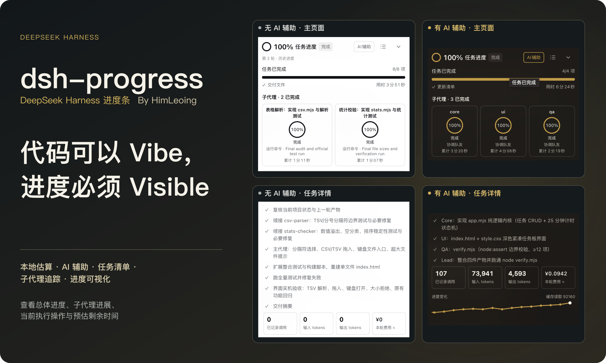
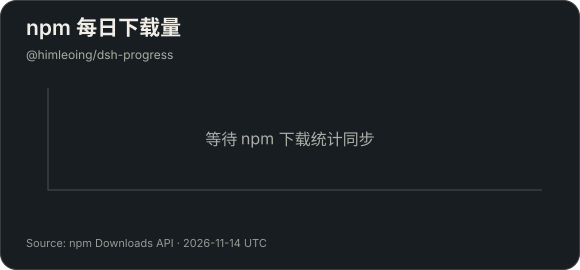
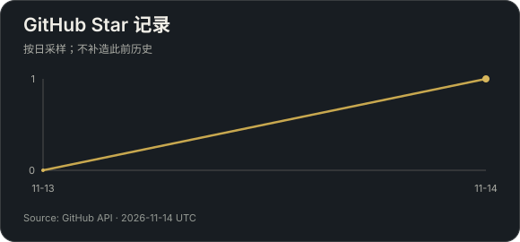

<p align="center"></p>

<p align="center"><a href="#安装">安装</a> · <a href="#两种评估方式">两种评估方式</a> · <a href="#界面结构">界面结构</a> · <a href="README.md">English</a> · <a href="https://github.com/HimLeoing/dsh-progress/releases">发布记录</a></p>

**dsh-progress** 是 [DeepSeek Harness](https://github.com/deepseek-ai/deepseek-harness) 网页版任务进度插件。查看总体进度、当前工作、剩余时间和每位队友的进展；选择本地估算或 AI 辅助，按需要展开细节。

## 两种评估方式

<table>
<tr><th width="50%">本地估算</th><th width="50%">AI 辅助</th></tr>
<tr><td align="center"></td><td align="center"><br><sub>评估用量与趋势（完成后）</sub><br></td></tr>
<tr><td>依据执行证据、任务阶段与清单权重估算；没有历史记录也能使用。</td><td>按执行节点使用模型评估，结合清单权重与队友进展更新估算。</td></tr>
<tr><td>不发送额外模型请求；展示估算百分比与按分钟显示的剩余时间。</td><td>显示估算百分比、按秒变化的剩余时间，并汇总主代理与队友的探针费用。</td></tr>
</table>

两种模式都支持任务清单、独立队友进度和运行中切换。AI 辅助默认关闭，开启后可能产生提供方费用；百分比与剩余时间都属于估计，实际返工可以回退。以下图片均来自真实任务运行。

## 界面结构

<p align="center"></p>

## 任务详情与开发者模式

<table>
<tr><th width="50%">任务详情</th><th width="50%">开发者模式</th></tr>
<tr><td align="center" valign="top"><a href="docs/assets/task-details.png"></a></td><td align="center" valign="top"><a href="docs/assets/developer-mode.png"></a></td></tr>
<tr><td>一次展开查看清单、进度曲线和探针用量；费用统计已内置。</td><td>开启后记录调用时间、完整输入与输出；日志只保存在本机，可查看或下载。</td></tr>
</table>

这两张截图来自同一轮实际复核：三项清单、97 项测试通过、5 次评估。点击图片可查看原尺寸；开发者模式默认关闭。

## 从开始到完成

<table><tr><th>开始</th><th>进行中</th><th>完成</th></tr><tr><td></td><td></td><td></td></tr></table>

<details><summary>深浅色对比</summary>

<table><tr><th>深色</th><th>浅色</th></tr><tr><td></td><td></td></tr></table>

</details>

## 如何工作

<p align="center"></p>

## 安装

需要 **DeepSeek Harness >=0.2.2-rc.1**（Web 端与 Desktop 端）和 **Node.js >=24.9.0**；已在宿主 0.2.2-rc.3 验证。

从 npm 安装：

```sh
dsh plugin --profile web add "@himleoing/dsh-progress@0.1.1-rc3"
```

或从 GitHub 安装同一版本：

```sh
dsh plugin --profile web add "github:HimLeoing/dsh-progress#v0.1.1-rc3"
```

也可从 [Release](https://github.com/HimLeoing/dsh-progress/releases/tag/v0.1.1-rc3) 下载 .tgz 安装包。在插件页启用，重启 Harness，再刷新网页。旧版数据会在目标文件不存在时迁移，原文件保留。

普通模式检查更新的 RC；开发者模式同时检查更新的 Alpha。符合条件的新版本出现时，任务详情底部版本号旁显示圆形更新按钮。

## 更多说明

[使用与估算说明](docs/guide.zh-CN.md) · [更新记录](CHANGELOG.md) · [反馈问题](https://github.com/HimLeoing/dsh-progress/issues) · [参与贡献](CONTRIBUTING.md)

任务详情提供清单、趋势和内置探针计价；开发者模式提供评估观察与日志。只有宿主确认成功完成才显示 100%。最低宿主版本范围允许后续版本安装，未来若有破坏性接口变更仍可能需要适配。

## 项目统计

<table><tr><th width="50%">npm 每日下载量</th><th width="50%">Star 记录</th></tr><tr><td></td><td></td></tr></table>

统计由公开 API 每日更新。npm 图仅统计 `@himleoing/dsh-progress`，新发布后的数据可能延迟；Star 从首次采样起记录，不补造过去的曲线。

[MIT 许可证](LICENSE) · [第三方许可说明](THIRD_PARTY_NOTICES.md)
