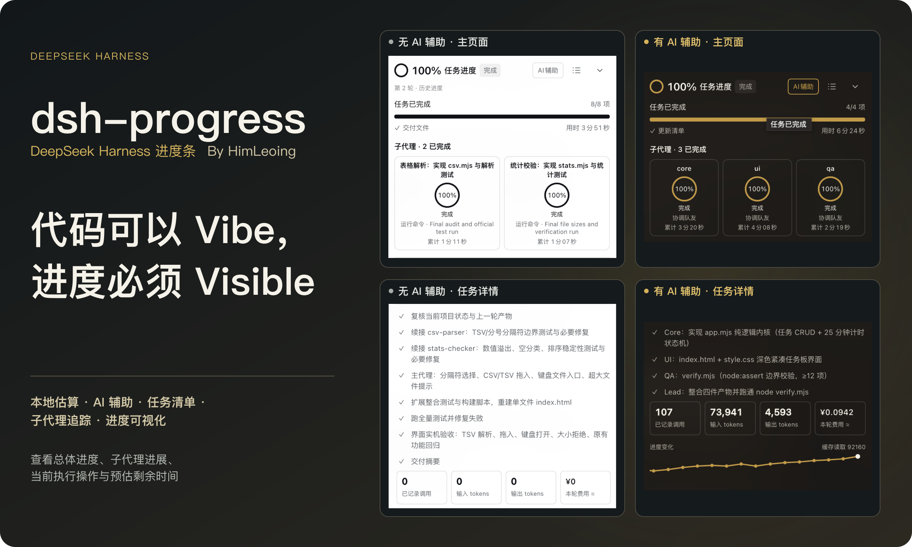

查看总体进度、子代理进展、当前执行操作与预估剩余时间。

## 本地估算与 AI 辅助

- **本地估算**：默认使用，不发送额外模型请求。根据执行证据、任务清单与权重展示估算百分比和剩余时间，无历史记录也能使用。
- **AI 辅助**：按需开启，在执行节点使用当前会话的模型评估进展；优先使用 Off 强度，不支持时采用模型最低可用强度。

两种方式都支持任务清单、独立子代理进度、运行中切换和历史轮次查看。

## 一个面板，看清当前工作

- **总体进度**：主任务的估算完成度、实际用时与预估剩余时间。
- **当前操作**：读取、写入与命令等活动单独展示；有可观测总量时显示确定进度。
- **子代理追踪**：独立卡片展示名称、进度与当前操作，点击进入子任务详情。
- **任务详情**：查看任务清单、进度变化与内置探针计价。
- **开发者模式**：按需记录和查看评估调用的时间、输入、输出与用量。日志保存在本机，可能包含对话和文件片段。

## 费用与估算

AI 辅助默认关闭。开启后，输入、缓存输入与输出仍可能产生提供方费用。“本轮费用 ≈”合计主代理与所有子代理的进度探针费用，不含执行项目本身的模型费用；计价已内置，无需额外插件。

百分比与剩余时间都是估计。返工或范围变化可能使进度回退、剩余时间增加；只有宿主确认本轮成功结束，才显示 100%。

## 使用要求与更新

- DeepSeek Harness **>=0.2.2-rc.1**，支持 Web 端与 Desktop 端。
- Node.js **>=24.9.0**。

安装后启用插件，重启 Harness 并刷新网页。旧版数据在目标文件不存在时迁移，原文件保留。

任务详情底部显示当前版本；普通模式检查更新的 RC，开发者模式也检查更新的 Alpha。符合条件的新版本出现时，版本号旁会显示圆形更新按钮，安装前提示重启宿主。

[查看 GitHub 项目与发布记录](https://github.com/HimLeoing/dsh-progress)
